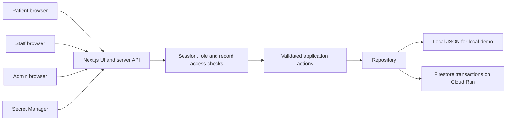

# CAREBRIDGE

**Healthcare coordination from appointment to emergency.**

CareBridge brings appointments, clinic queues, ambulance requests, blood requirements and healthcare directories into one connected workspace. It is a hackathon demonstration using fictional people and facilities around Pune, India.

> CareBridge supports healthcare administration and emergency coordination. It does not provide medical diagnosis or treatment recommendations.

**Deployment status:** Cloud Run deployment assets are included. A live deployment is not yet verified: a Google Cloud project with billing and an authorized account must first be supplied. See [Cloud Run deployment](docs/CLOUD_RUN.md). Do not submit a localhost address as the jury URL.

## Problem and solution

Small clinics coordinate through calls, notebooks, WhatsApp and spreadsheets. An appointment can become disconnected from the reception queue, while families separately search for transport, blood banks and facilities.

CareBridge connects these administrative workflows around a patient. Its Emergency Coordination Record links an ambulance request, a blood requirement, a selected facility and timestamped activity, so the user can see what has happened in one place.

## Three distinct experiences

| Role | Main responsibilities | Login |
| --- | --- | --- |
| Patient | Own appointments, profile, reminders and emergency coordination | `/patient/login` |
| Clinic staff | Clinic patients, appointment queue, follow-ups and request coordination | `/staff/login` |
| Admin | Users, directories, resources and platform activity | `/admin/login` |

The public landing page is **Care Desk**. Role permissions are enforced by server authentication and API authorization, in addition to separate navigation.

## Core workflows

- **Appointments:** book, reschedule, cancel and move through reception statuses; completing a visit records an administrative history entry.
- **Clinic operations:** patient records, today's queue, useful counts, reminders and activity.
- **Emergency coordination:** ambulance request, assignment and status timeline linked to an emergency record.
- **Blood network:** blood group/location search, availability labels and update timestamps, plus blood requirement tracking.
- **Healthcare directory:** seeded hospitals, clinics and blood banks with contact and directions links.
- **Admin controls:** account status and operational resource management.
- **Shared experience:** global search, in-app notifications and a connected fictional demo scenario.

Directory distances and resource availability are **demo information**, not live GPS, a verified blood reservation or a real dispatch service. Active workspaces refresh every seven seconds and when the browser regains focus.

## Technology and architecture

Next.js App Router, React, TypeScript, Lucide icons, Zod validation and Firebase Admin SDK. The application ships a standalone Node server in a multi-stage Docker image. The UI uses a shared responsive design system.



- `app/` — routes, layouts and API handlers.
- `components/` — reusable presentation and workflow components.
- `lib/types.ts` — shared administrative domain types.
- `lib/server/` — authentication, authorization, validation, seeding and repository logic.
- `scripts/` — deployment helpers.
- `docs/` — architecture, demo and acceptance material.

## Local development

Use Node.js 22 LTS and npm. From the project directory:

```powershell
npm ci
Copy-Item .env.example .env.local
npm run dev
```

Open [http://localhost:3000](http://localhost:3000). `.env.example` enables demo mode and local JSON storage. Development permits a local signing fallback; public deployment must use a generated `SESSION_SECRET` from Secret Manager.

The first read seeds `.data/carebridge.json`. Local storage persists across server restarts on this machine. It is intended for one Node process and must not be used as durable Cloud Run storage. Keep this file and all `.env` files out of source control and image uploads.

### Build and validate

```powershell
npm run typecheck
npm test
npm run build
npm run test:integration
```

The integration suite starts an isolated production server with disposable fictional data. See [validation results](docs/VALIDATION.md) for the completed checks and deployment limitations.

For a production build tested over **localhost HTTP**, set `DEMO_MODE=true`, a random `SESSION_SECRET` with at least 32 characters, and `SESSION_COOKIE_SECURE=false` in `.env.local`, then run `npm run start`. Remove the cookie override for public HTTPS. The Cloud Run scripts do not set it.

The health endpoint is `GET /api/health`. It reads the configured store and returns HTTP 200 with `{status, service, mode, storage, timestamp}` when healthy, or HTTP 503 if the storage check fails. Use it alongside authenticated workflow checks; health alone does not prove the demo journey works.

## Demo accounts

| Role | Email | Demo password |
| --- | --- | --- |
| Patient | `patient@carebridge.demo` | `CareBridge@123` |
| Staff | `staff@carebridge.demo` | `CareBridge@123` |
| Admin | `admin@carebridge.demo` | `CareBridge@123` |

These accounts are intentionally shared for judging, and only work while demo mode is enabled. They must contain fictional information only. A shared admin can change demo state, so use a separate demo deployment rather than a real clinic dataset.

Seed data includes fictional patients, clinic staff, appointments, ambulances, blood banks and inventory, facilities, emergency records, notifications and activity. Seed dates are generated for the demo rather than relying on a fixed event date.

## Environment variables

| Name | Purpose | Default / requirement |
| --- | --- | --- |
| `DEMO_MODE` | Enables fictional seeded accounts and demo scenario | Development defaults on; set explicitly to `true` for the jury deployment |
| `SESSION_SECRET` | HMAC session signing secret | At least 32 random characters; required for a secure public deployment |
| `DATA_BACKEND` | Repository selection | `local` or `firestore`; Cloud Run uses `firestore` |
| `DATA_FILE` | Override local JSON file path | `.data/carebridge.json` |
| `GOOGLE_CLOUD_PROJECT` | Project for Firebase Admin/Firestore | Set by deployment script |
| `FIRESTORE_DOCUMENT` | Aggregate demo document | `carebridge/state` |
| `SESSION_COOKIE_SECURE` | Cookie HTTPS behavior | Secure in production; only use `false` for local HTTP smoke checks |
| `PORT` | Listening port | Cloud Run supplies it; Docker defaults to `8080` |

Local Firestore access may use `gcloud auth application-default login`. Cloud Run uses its attached runtime service account through Application Default Credentials; no service-account key file is packaged. `FIREBASE_PROJECT_ID` is also accepted by the backend as a project fallback.

## Database design

The logical datasets are `users`, `patients`, `clinics`, `appointments`, `visitHistory`, `followUpReminders`, `ambulances`, `ambulanceRequests`, `bloodBanks`, `bloodInventory`, `bloodRequests`, `healthcareFacilities`, `emergencyRequests`, `notifications` and `activityLogs`. Staff identity and clinic assignment are held in `users` rather than duplicated into a separate staff table.

The MVP stores these datasets together in **one versioned aggregate document**, locally or in Firestore. Firestore transactions make a connected action atomic, including its notifications and activity. This is a deliberate small-demo design, not one Firestore collection per entity. The aggregate is subject to Firestore's document-size limit and will need collection-level records, query indexes and more granular transactions before larger usage. See [architecture and data model](docs/ARCHITECTURE.md).

## Cloud Run deployment

The quickest path is [Google Cloud Shell](https://shell.cloud.google.com/), which already has the Google Cloud CLI. After creating a project, linking billing and uploading the source:

```bash
bash scripts/deploy-cloud-run.sh YOUR_PROJECT_ID asia-south1 --bootstrap
```

From Windows with Google Cloud CLI installed:

```powershell
gcloud auth login
.\scripts\Deploy-CareBridge.ps1 -ProjectId YOUR_PROJECT_ID -Bootstrap
```

The setup enables the required APIs, provisions the named runtime/build service accounts, creates a default Native Firestore database if absent, and generates a session secret in Secret Manager. Cloud Build uses the included Dockerfile; a local Docker installation is not needed. The script deploys a public fictional demo and checks health against its returned HTTPS URL. Review the complete [deployment guide](docs/CLOUD_RUN.md), including prerequisites, permissions and troubleshooting, before running it.

## Jury demo

Start with one sentence: **“CareBridge connects a small clinic's appointment queue with the family's ambulance, blood and facility coordination.”**

Show Care Desk's three roles, book an appointment as the patient, progress it through reception as staff, then create and assign transport. Return to the patient to show the shared status, O+ blood search, a blood requirement and the connected emergency timeline. Finish with the admin overview.

Use the [three-minute presentation script](docs/DEMO_SCRIPT.md) and [manual acceptance checklist](docs/ACCEPTANCE_CHECKLIST.md). Prepare separate browser profiles for the three roles so their session cookies do not overwrite one another.

## Security and medical safety

Server-side role and record ownership checks protect actions and state responses. Sessions use signed, HttpOnly cookies. Mutations validate their payloads. Account status is checked during authentication. Secret files and local data are excluded from Docker and Cloud Build uploads.

`firestore.rules` denies browser/client access. Server Admin SDK access is governed by IAM and application authorization, and bypasses these rules. The optional Firebase ID-token backend path requires Firebase Authentication setup and a securely provisioned `firebaseUid` to application-user mapping; public self-registration is not a production onboarding flow provided by this demo.

CareBridge does not diagnose, prescribe, recommend treatment, rank clinical urgency or promise ambulance/blood availability. It is a software coordination prototype, not a production health-record system or emergency dispatch provider. Emergency transport categories are administrative labels only. Real emergencies require the appropriate local emergency service.

## Screenshots

Add final screenshots after verifying the corresponding views:

| Screenshot | Suggested filename |
| --- | --- |
| Care Desk and three roles | `docs/screenshots/care-desk.png` |
| Patient overview | `docs/screenshots/patient-dashboard.png` |
| Clinic queue | `docs/screenshots/staff-queue.png` |
| Emergency Coordination Record | `docs/screenshots/emergency-coordination.png` |
| Admin overview | `docs/screenshots/admin-dashboard.png` |

## Future scope

Per-entity Firestore collections; clinic invitations and identity lifecycle management; verified partners and inventory freshness; optional real Maps/Places integration; consent-based notification channels; localization; accessibility audits; rate limiting and production monitoring. These are extensions, not claims about the hackathon build.

**Team:** add participant names, responsibilities and submission contact here.

## References

- [Next.js self-hosting](https://nextjs.org/docs/app/guides/self-hosting) informs the Node/Docker deployment approach.
- [Google Cloud Run Node.js quickstart](https://docs.cloud.google.com/run/docs/quickstarts/build-and-deploy/deploy-nodejs-service) covers source deployment.
- [Cloud Run secrets](https://docs.cloud.google.com/run/docs/configuring/services/secrets) covers Secret Manager injection.
- [MLH judging guidance](https://github.com/MLH/mlh-hackathon-organizer-guide/blob/master/general-information/judging-and-submissions/judging-plan.md) informs the compact demonstration story.
